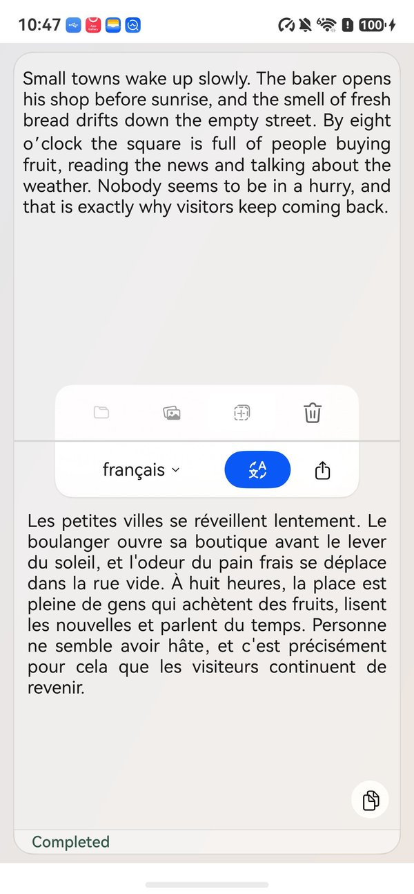
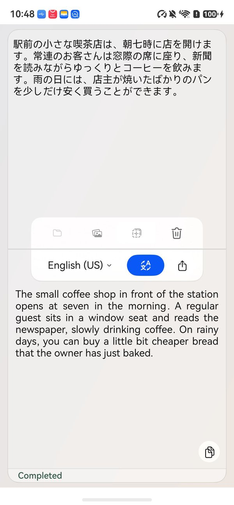
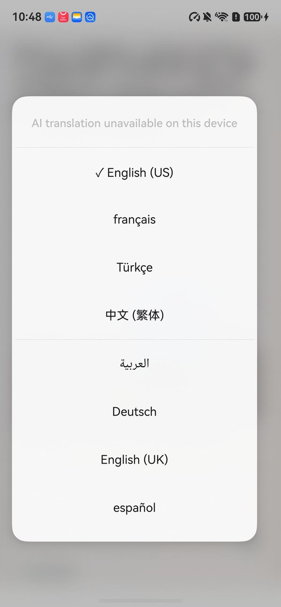
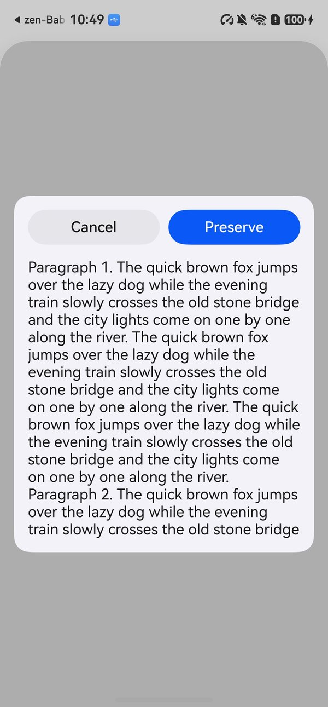
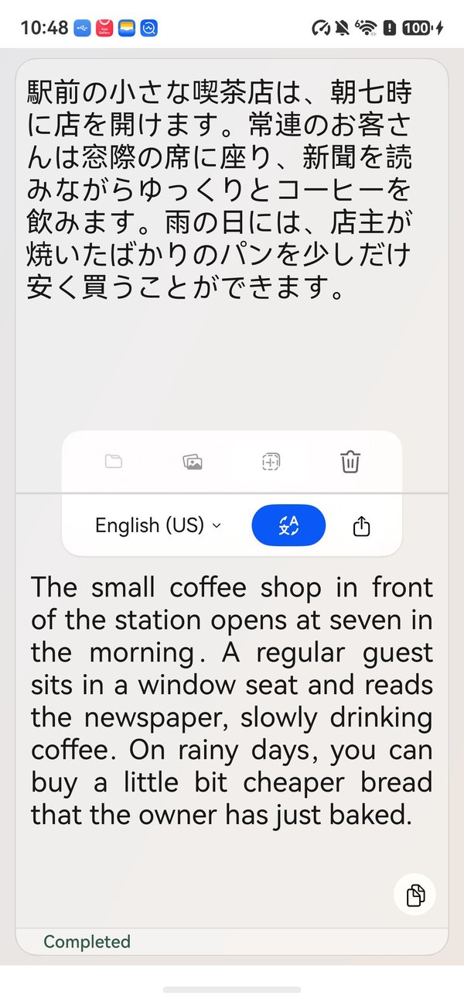

<p align="center"></p>
<h2 align="center"><b>zen-Babel</b></h2>
<h4 align="center">The local-first translation app for iOS, rebuilt natively for HarmonyOS.</h4>

<p align="center"></p>

> ### Please read this first
>
> This is an unofficial community port. It is not affiliated with, endorsed by, or supported by
> the author of zen-Babel. If something here is broken, it is broken here. Do not open an issue
> upstream for it.
>
> The name zen-Babel (zenバベル) and the app icon belong to the upstream author. The MIT License
> covers the source code, not the name and not the artwork. Both are used here only to say what
> this is a port of, and both will change if the upstream author would rather we did not use them.

<p align="center"><a href="#screenshots">Screenshots</a> &bull; <a href="#install">Install</a> &bull; <a href="#known-limits">Known limits</a> &bull; <a href="#function-list-comparison">Function list comparison</a> &bull; <a href="#license">License</a></p>

<hr>

zen-Babel for iOS is a local-first translation app: the text you translate stays on your phone.
This repository is that app rewritten for HarmonyOS in ArkTS, against ArkUI. It has the same
translation screen with the source and output panes, the target language menu, sentence-by-sentence
translation that you can stop, pinch-to-zoom text,
import from files and photos with text recognition, the share card that sends text, PDF, Word
documents and images from other apps, and the Developer Panels.

Upstream lives at [ttrace/pre-babel-lens](https://github.com/ttrace/pre-babel-lens).
This port is based on zen-Babel 0.9.0 (upstream tag
[`v0.9.0`](https://github.com/ttrace/pre-babel-lens/tree/v0.9.0), plus the two commits up to
`de5465c` of 19 April 2026).
If you are on an iPhone or a Mac, go there instead. This port exists for people whose phone runs
HarmonyOS and who want the same translation app on it.

On iOS, zen-Babel translates with the Apple Translation framework. HarmonyOS has no system
translation service, so this port translates with Meta's
[NLLB-200](https://huggingface.co/facebook/nllb-200-distilled-600M) model (the distilled 600M version,
CC-BY-NC 4.0), converted for MindSpore Lite, the inference engine built into HarmonyOS. The model ships
inside the app, so translation runs entirely on the phone and needs no network connection at all.
Because of the model's license, builds of this app are for non-commercial use only.

## Screenshots

<p align="center">





</p>

The texts in these screenshots were written for them. The translations are the app's own output.

## Install

There is no prebuilt package here. You build it and sign it yourself, which also means the package
carries your certificate and your device list rather than someone else's.

You need DevEco Studio 6.x with the HarmonyOS SDK 6.1.1 (API 24), a Huawei developer account,
a phone running HarmonyOS, and a network connection for the first build.

1. Clone this repository:

   ```bash
   git clone https://github.com/etspworks/ZenBabel-HarmonyOS.git
   ```

   The translation model is not checked in (about 910 MB). The first build downloads it from
   [Hugging Face](https://huggingface.co/etspworks/nllb-200-distilled-600m-mindspore-lite) into
   `entry/src/main/resources/resfile/nllb/` and checks every file against its pinned SHA-256 (see
   `entry/hvigorfile.ts`). `tools/nllb/convert.sh` is how those files are made from
   `facebook/nllb-200-distilled-600M`; you only need it to rebuild the model yourself.

2. Open the folder in DevEco Studio. Go to **File > Project Structure > Signing Configs**. Sign
   in, connect the device, and let DevEco generate a signature. The bundle name is
   `com.etspworks.ZenBabel.hmos`.
3. Build it: **Build > Build Hap(s)/APP(s) > Build Hap(s)**. The first build downloads the model
   and compiles the native engine (`libnllb_napi.so`, arm64-v8a). The package, about 915 MB
   with the model, lands in `entry/build/default/outputs/default/`.
4. Install and launch it:

```bash
hdc install -r entry-default-signed.hap
hdc shell aa start -a EntryAbility -b com.etspworks.ZenBabel.hmos
```

A generated debug signature only installs on the devices registered to it, and it expires. When it
does, open the same dialog and generate it again.

## Known limits

- Standard translation is NLLB-200 (distilled 600M), not Apple's models, and its quality differs
  from the Apple Translation framework: it can be literal or miss idioms. It translates every pair
  directly, without going through English, Traditional Chinese included.
- The model takes about 2.4 GB of memory while the app is open, and the first translation after
  launch loads it, which takes about 8 seconds.
- The NLLB-200 model is licensed CC-BY-NC 4.0: builds of this app must not be used commercially.
- AI translation needs an on-device AI model. On phones without one, the target language menu
  shows "AI translation unavailable on this device" and only standard translation is offered.
- The source language is identified with Google's CLD3 language detector, built into the app, plus
  word lists for very short text (iOS uses Apple's language recognizer). A single word can still be
  misread or go undetected; undetected text is treated as English.
- Developer Mode is a switch at the end of the target language menu. On iOS it lives in the
  Settings app, which HarmonyOS apps cannot add to.
- Launch text is passed as the Want parameter `launchArguments` (a JSON array of strings), since
  HarmonyOS apps receive no process arguments:
  `hdc shell aa start -a EntryAbility -b com.etspworks.ZenBabel.hmos --ps launchArguments '["Hello","world"]'`
- The macOS features of zen-Babel (double-copy quick launch, window layouts) are not part of this
  port, which follows the iOS app.
- Phones only, arm64 only. There is no tablet or watch layout.

## Function list comparison

| Module | Rows | Both | iOS | HarmonyOS |
|---|---:|---:|---:|---:|
| Translation | 34 | 29 (85%) | 3 | 2 |
| Target Language Menu | 8 | 4 (50%) | 4 | 0 |
| Developer Panels | 5 | 5 (100%) | 0 | 0 |
| Share Card | 21 | 20 (95%) | 1 | 0 |
| Global | 13 | 4 (31%) | 6 | 3 |
| **Total** | **81** | **62 (77%)** | **14** | **5** |

The iOS list has 76 functions and this port's list has 42. The port's list is shorter
mostly because it puts the share card's preview cases, the alerts and the pickers in one row each, so
those iOS rows count as in both. Most of the 14 iOS-only rows (6 of them in Global) are things the
port also does but its list does not count as a function: restoring the settings on relaunch,
translating offline, the five UI languages, and the disabled and dimmed items of the target language
menu; the compact reading gestures are switched off in the code of both apps. Two are really missing:
the language download and its prompt, which the port does not need because its model ships in the app.
The 5 HarmonyOS-only
rows are the launch from the app icon, the HarmonyOS launch parameters (`sendData` and `targetPage`),
selecting the output text, and dismissing an alert with the back gesture.
The full table, one row per function with a note wherever the two apps differ, is in
[docs/FUNCTION_LIST_COMPARISON.md](docs/FUNCTION_LIST_COMPARISON.md).

## License

MIT, the same as upstream. `LICENSE` is the upstream file, unchanged:

```
Copyright (c) 2026 Taiyo Fujii
```

Everything written for HarmonyOS is released under those same terms. `NOTICE` lists the
third-party software built into the app: SentencePiece and CLD3 (Apache-2.0), protobuf-lite
(BSD-3-Clause), and the NLLB-200 translation model by Meta, which is licensed CC-BY-NC 4.0, not MIT:
the app's source code is free to use under MIT, but a build that bundles the model may only be used
non-commercially. MindSpore Lite is part of HarmonyOS and is not bundled.

More about zen-Babel: [github.com/ttrace/pre-babel-lens](https://github.com/ttrace/pre-babel-lens)
